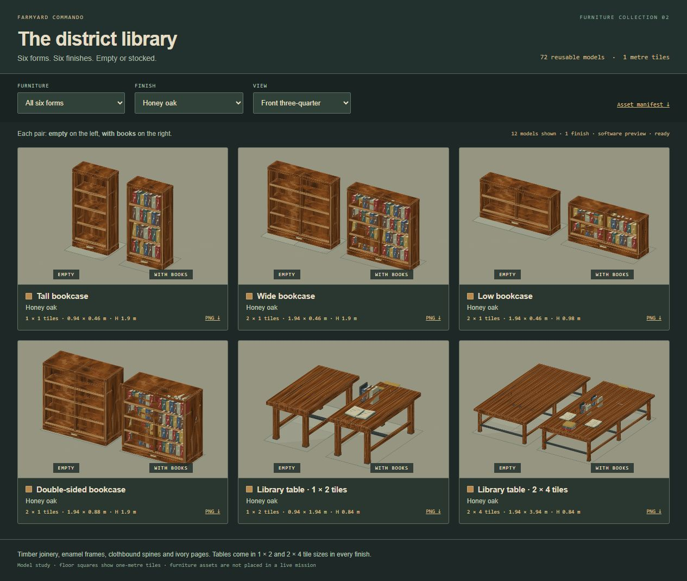
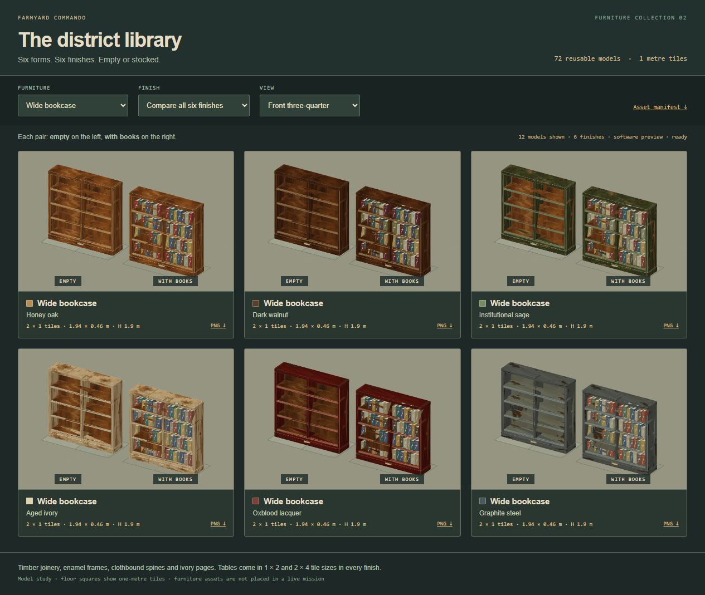
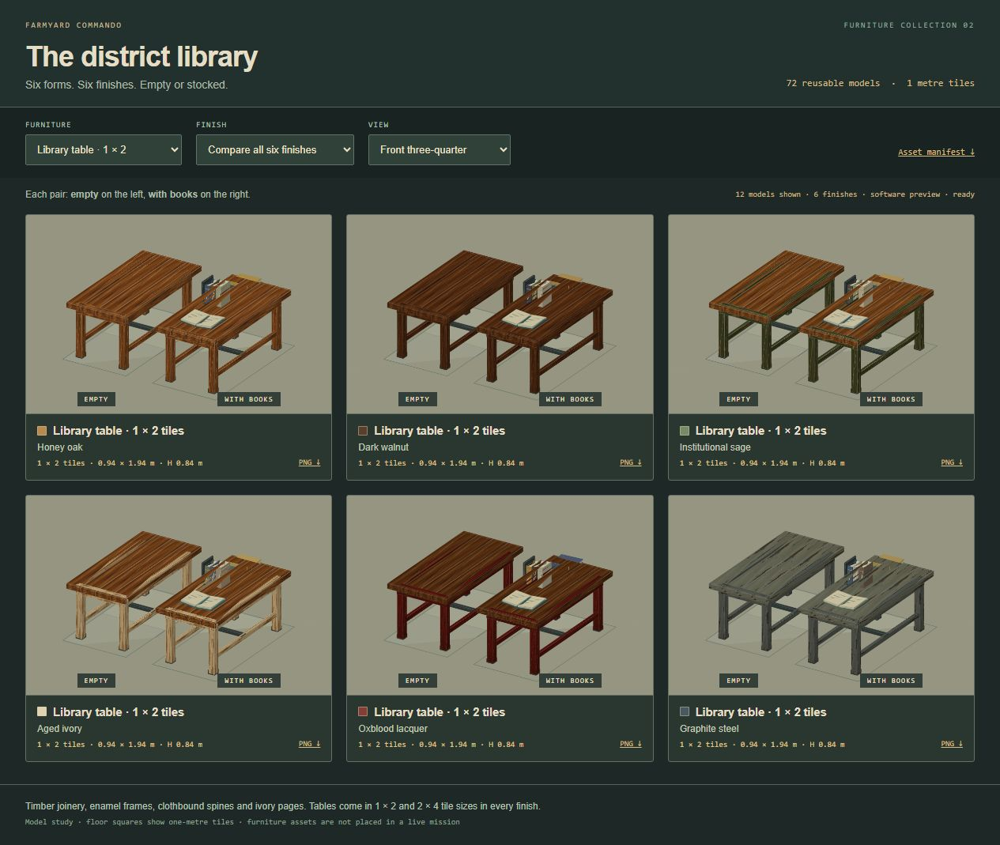
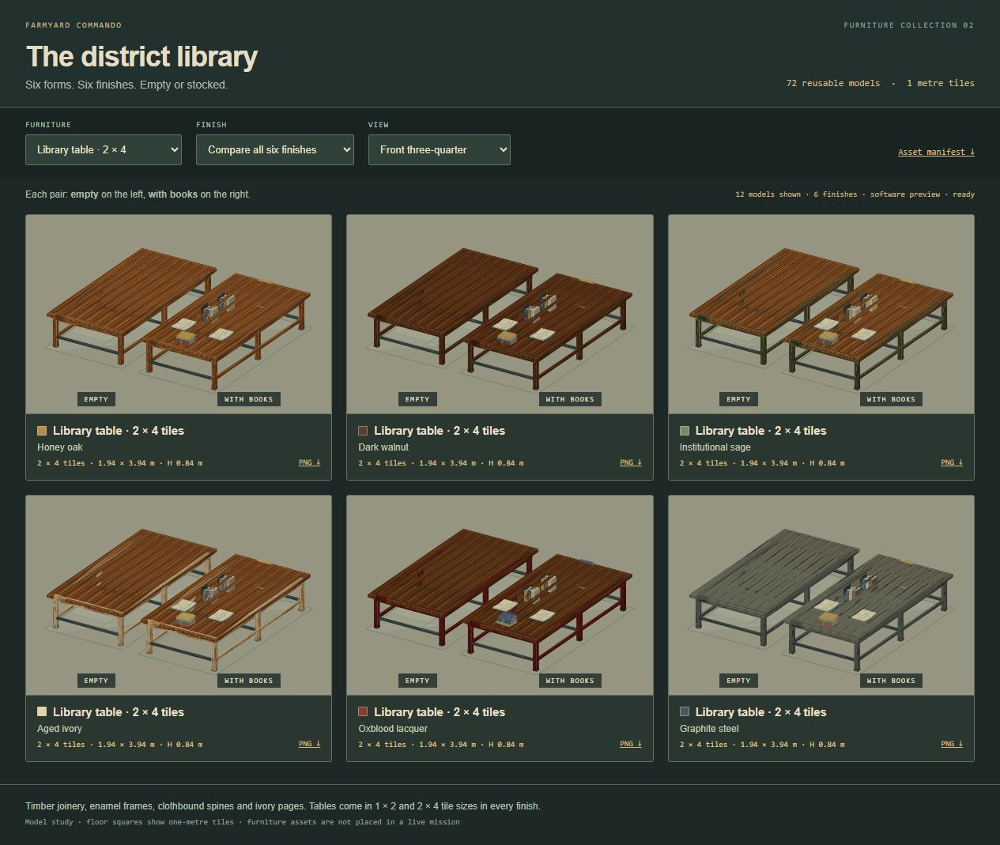
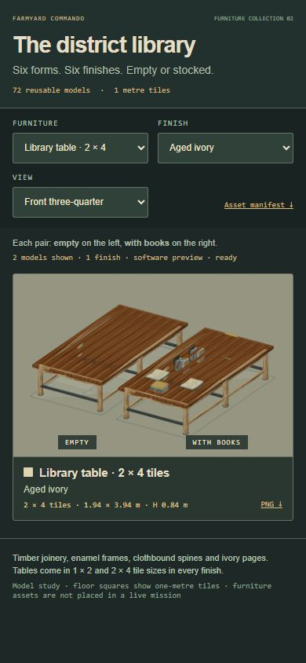

# District library furniture

**72 reusable assets:** six forms × six skins × two contents states. This is an additive native Three.js furniture library, based on public Farmyard Commando commit `60aeeed`. No mission placements or existing AFT snapshot files are changed.



| Form ID | Tile reservation | Body width × depth | Height |
| --- | --- | --- | --- |
| `bookcase-tall` | 1 × 1 | 0.94 × 0.46 m | 1.90 m |
| `bookcase-wide` | 2 × 1 | 1.94 × 0.46 m | 1.90 m |
| `bookcase-low` | 2 × 1 | 1.94 × 0.46 m | 0.98 m |
| `bookcase-double` | 2 × 1 | 1.94 × 0.88 m | 1.90 m |
| `library-table` | **1 × 2** | **0.94 × 1.94 m** | 0.84 m empty; ≤1.18 m with books |
| `library-table-large` | **2 × 4** | **1.94 × 3.94 m** | 0.84 m empty; ≤1.18 m with books |

Every form has `empty` and `books` states. Double-sided cases stock both faces. Tables have horizontal stacks, upright books supported by metal bookends, and open volumes with separate covers, page blocks and a central gutter. The 2 × 4 communal table has six legs, extra braces and four reading places; books retain their physical size. Book placement stays identical across skins so a finish change cannot alter layout or collision.

The six finish IDs are `oak`, `walnut`, `sage`, `ivory`, `oxblood`, and `graphite`. Oak/walnut expose the wood grain; sage, ivory and oxblood use painted frames with timber shelves and reading surfaces. Graphite uses steel surfaces. Clothbound books share muted red, blue, green, ochre and ivory palettes, with broad spine bands and labels.







## Reuse

The asset source is [furniture.js](../../../sites/tactical-animal/dist/art/library/furniture.js); forms, skins and stable IDs are in [catalog.js](../../../sites/tactical-animal/dist/art/library/catalog.js). The generated [catalog.json](../../../sites/tactical-animal/dist/art/library/catalog.json) contains all 72 variants, base dimensions and placement offsets, source hashes and rights notes. `specification()` computes the rotated dimensions and reservations for each quarter-turn.

```js
import {loadLibraryTextures, createLibraryFurniture} from './art/library/furniture.js';

const textures = await loadLibraryTextures();
const library = createLibraryFurniture(textures);
const asset = library.build('library-table', 'sage', 'books', {rotation: 0});
scene.add(asset.root);

// Asset IDs use library.<form>.<skin>.<empty|books>.
// Register matching gameplay geometry before placing a solid in a live map.
const solidParts = asset.solidParts();

// On removal: unregister collision first, release this asset's instance buffers.
asset.dispose();
// On unloading the furniture set: release shared buffers/maps, then borrowed inputs.
library.dispose();
textures.dispose();
```

`build()` returns `root`, `spec`, local `parts`, build-time `bounds`, `solidParts()` and idempotent `dispose()`. `rotation` accepts 0/90/180/270 degrees about renderer +Y; front faces +Z at zero. Roots are centered on their footprint, with ground at Y=0. To place at the first occupied tile's cell center, add `spec.placementOffset` to that cell coordinate. Unrotated table offsets are `(0,0.5)` for 1 × 2 and `(0.5,1.5)` for 2 × 4. When translating or rotating a root later, call `solidParts()` again to obtain current world transforms.

Tile reservations describe editor spacing. Navigation uses the actual body footprint in `spec.navigationFootprint`, not an opaque full-tile box. Sight and projectiles use returned solid geometry with copied world matrices, preserving the gaps under tables and between shelves. Tiny labels, spine bands and trim are decorative. `solidParts()` borrows the library's geometry; consumers must not dispose those buffers or retain registrations after unloading the library.

Each root batches identical geometry/materials into instanced meshes. Even a stocked double-sided case uses fewer than 20 material batches. Individual roots own their instance buffers; the library owns its two shared geometries, finish materials and cropped texture clones. The two source atlases remain owned by the caller. No lights, timers, animation loops or image requests are created by importing the furniture module. `loadLibraryTextures()` explicitly loads only the two used atlases and releases a successful partial load if its partner fails.

This pack does not register entries in the frozen AFT designer or place furniture in gameplay. A consuming editor/mission should use the supplied IDs, placement offsets and body geometry, convert its angle convention to renderer +Y, and include this owned module namespace in its normal cache-versioning path. These are integration hooks, not additional art dependencies.

## Catalog review

After `npm run build`, serve the project and open `/art/library/index.html`. Select any form and finish, or compare all six skins. Each card shows empty on the left and stocked on the right; front, back and overhead views are available. Floor squares are one metre. PNG links expose browser image downloads, which were not verified in this session; the reusable models are the native factory and its catalog.

The catalog normally uses WebGL. This session's in-app browser could not create a WebGL context, so evidence uses the built-in software snapshot renderer. It projects the **same actual model triangles** and samples the **same inherited atlases**; lighting is approximate and shadows differ from the game. WebGL shading has not been visually verified in this session. Geometry, tile dimensions, contents, material assignments and front/back orientation were reviewed through the software path. The catalog identifies the active preview mode.



## Sources and validation

The painted wood/metal atlases and bevel helper come from the user-supplied AFT snapshot at `a20b343a0234b5d8b365a4e1668961ca1bf37653`. The inherited `dining-table` provides the four-board top, legs, apron language and 0.84 m table height. New bookcase, table and book layouts are project contributions. Inherited files remain untouched. The repository does not declare an upstream art license or a project-wide license for the new art; the manifest records this status without relabeling art as MIT. Three.js retains its separate MIT notice.

Regenerate the manifest with `node sites/tactical-animal/tools/library-catalog.mjs`. Tests cover all 72 variants at four rotations, bounds, equal geometry across skins, genuinely empty contents, both faces of the double case, table sight gaps, communal-table supports and reading places, disposal/ownership, partial load failures and source hashes. Browser evidence and source hashes are recorded in [review.json](review.json). Temporary preview helpers are stopped after QA.
