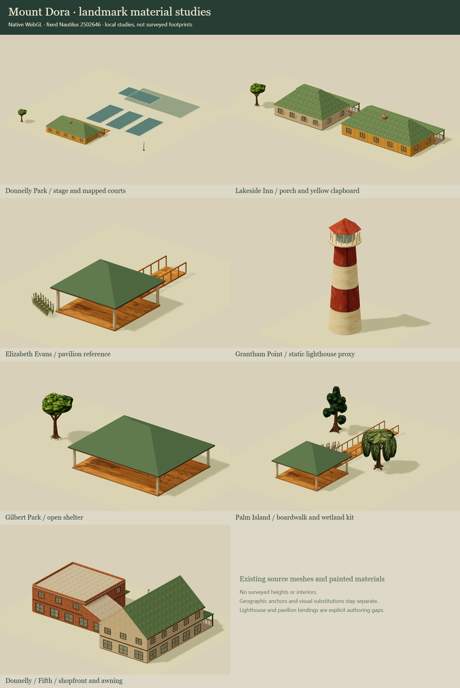

# Mount Dora landmark art

## Production integration

The [production kit contract](production.md) supplies exact-footprint town
placements, bounded native meshes and matching movement-solid records. The
original gallery below remains the preserved authoring reference. The architect
owns the final playable-tour integration and route checks.

This authoring sidecar targets Nautilus workshop **2502646482218524fd5129641da769bb82462e4d**. It is separate from Coldwell and guard work, uses released Farmyard **251bf8094b5f9ebe44208443084c1a6d6658512a**, and changes no game/engine pin. The architect owns projection, terrain, footprints, shoreline, sectors, integration and promotion.

## Early manifest contract

[maps/mount-dora/art/manifest.json](../../../maps/mount-dora/art/manifest.json) defines seven treatment groups. [geography.json](../../../maps/mount-dora/art/geography.json) preserves 68 original OSM feature identities and projected points. `source/selected-assets.json` contains 24 actual public catalogue entries copied from the fixed source, not invented preset IDs.

Town coordinates are east/south metres, tangent origin Donnelly Park at 28.8010291, -81.6442229 plus `(480,480)`. North is up. The 1440 × 1680 m extent contains 6 × 7 sectors of 240 m. A town anchor already has the common shift: **do not add .5 m**. Only legacy integer tile centres convert with sector origin + local integer + .5.

Each landmark keeps a geographic source anchor separate from its visual treatment. Catalogue buildings demonstrate typology; their dimensions, footprints, heights and rooms do not become surveyed Mount Dora buildings. Source geography wins. Do not stretch a prefab, move a road/shoreline, replace the entire hotel with its one named small building, or cap a building at a sector cut. `referencesForSector` returns conservative source references only; the architect owns actual clipped pieces and town topology.

| Group | Treatment | Explicit uncertainty |
|---|---|---|
| Donnelly Park | Existing civic porch, shade trees, native court surfaces and fence/lights | Preserve five mapped court polygons as mapped. They are not proof of today's complete court count. Stage/deck and court paint are studies. |
| Lakeside Inn | Yellow clapboard, ivory trim, green roofing, deep veranda; existing depot/cottage/inn typologies | Eight associated OSM structures keep their own identities; named small way 560095897 is not the whole hotel. No surveyed interiors/heights. |
| Elizabeth Evans Park | Timber/green roof lakefront pavilion theme | Source label is Evans Park. Bowling shelters are not relabelled as the lakefront pavilion. Precise pavilion point remains unresolved. |
| Grantham Point | Red/ivory static lighthouse study | Exact supplied anchor `(500.2877,1169.7989)`; no registered lighthouse preset, interior or functioning beacon is claimed. |
| Gilbert Park | Original mapped open shelters, picnic furniture and large shade trees | Roof/post studies retain two pavilion identities separately from restrooms. |
| Palm Island | Original wooden route, wetland foliage and railing theme | Bridge layer is not surveyed elevation. No public cabbage-palm or automatic boardwalk-rail preset exists in this catalogue. |
| Donnelly / Fifth shopfronts | Existing corner shop/store/market typologies and awnings | Individual businesses retain source footprints; catalogue room plans are illustrative. |

`validateLandmarkArt` rejects unknown assets and missing identities. `requireCatalogueBindings` rejects missing host bindings. Unsupported art stays explicit in the sidecar and handoff; nothing is silently dropped into a partial portable map.

## Evidence and reproduction

The architect supplied a complete public OSM API snapshot and tangent-plane vectors. Their exact input hashes are in `source/provenance.json`; the derived subset retains OSM attribution and excludes contributor/account data. [OpenStreetMap attribution and licence](https://www.openstreetmap.org/copyright).

Official references establish visual/site identity: [City park inventory](https://mountdora.gov/1031/Parks-and-Playgrounds), [Grantham Point](https://www.mountdora.gov/facilities/facility/details/Grantham-Point-%208), [Palm Island city photo gallery](https://www.mountdora.gov/SlideShow.aspx?AID=12&AN=Palm+Island+Park), and [Lakeside Inn description](https://lakeside-inn.com/about-us/). The hotel confirms a yellow/white building group and veranda; city sources confirm the park facilities and wooden boardwalk. Photos are reference only; no photograph or map screenshot is embedded as a material/terrain texture. Precise site claims rely on the architect's geodata rather than unrelated web geocodes.

`tools/prepare.py PINNED_NAUTILUS_REPO VERIFIED_GEODATA_DIR` reads immutable Git objects, preserves notices/bytes, and reproduces the subset. No donor scripts or dirty worker modules are run. Native renderer examples, resource checks and a concrete workshop shortcomings report follow in the same draft PR. Art ownership is `maps/mount-dora/art/**`, this directory and the focused art test only.

## Native shape/material studies

`maps/mount-dora/art/three.js` exposes `createLandmarkStudy({THREE,id,atlas,prototypes,plantTextures,geography})`. It returns a local reference group, measured geometry stats and idempotent disposal. The host supplies Three and borrows the images; source materials, geometry and texture clones owned by the study are released on disposal. It is a detached gallery API, not an editor placement controller. No global town transform is applied by it.

The exact upstream building and roof renderer modules are copied with unchanged bytes. The study generator reuses frozen Farmyard/AFT factories for vegetation, table, reeds and streetlight geometry. Their source paths/revisions and image hashes are recorded in `source/prototypes.json`; it rejects an empty source model. Static parts with identical paint share batches and repeated parts share geometry. Foliage's gallery UV crop is simplified; the workshop keeps its existing richer native foliage shader.

Pavilion posts/rails/decks and the lighthouse are explicitly map-owned static reference forms using the existing kit's dimensions/materials. Their IDs are not added to the public engine catalogue. The civic/inn/shop interior plans remain the source kit's authored examples, not Mount Dora surveys. [Practical limitations and recommendations](shortcomings.md) distinguish engine limitations from missing geographical evidence.

To regenerate the references and review them without changing the engine checkout:

```powershell
python maps/mount-dora/art/tools/prepare.py PINNED_NAUTILUS_REPO VERIFIED_GEODATA_DIR
python maps/mount-dora/art/tools/verify-source.py PINNED_NAUTILUS_REPO
node maps/mount-dora/art/tools/build-studies.mjs
node --test sites/tactical-animal/tests/mount-dora-art.test.mjs
npm run check
npm run build
node maps/mount-dora/art/tools/serve.mjs
```

The art preview server prints its dynamic loopback URL, allows only this art subtree and its frozen render dependencies, honours `artifacts/mount-dora-art/STOP`, and stops automatically after 30 minutes. When launched for QA, enroll it in the user's helper lifecycle registry and stop it as soon as review finishes. It does not serve `.git`, app secrets, the active Nautilus checkout or other workers. No preview service is part of a delivered map.

This art handoff does not alter the production build. The integrated town release publishes the geographic atlas and native JSON downloads separately; these detached renderer studies remain repository authoring references. There is no game/engine pin update or automatic landmark placement in the final sectors.

`source/geometry-compatibility.json` verifies all nine reused AFT geometry/factory modules against immutable objects in both released Farmyard and the fixed Nautilus target. They match exactly after CRLF/LF normalization. The gallery retains the exact original building/roof modules and painted image bytes.

## Reviewed result

At art runtime commit **2b3755d3dcc427e7007e6c58f6ddf29772a8bbb2**, all seven studies rendered through **native WebGL 2** in the current in-app browser. The original 768 × 500 frames and contact sheet are saved alongside this document. Native rendering is now available; the older Coldwell browser limitation does not apply to this review.

All **397** repository tests pass, including **seven** focused art checks; the production build passes. The 390 × 844 gallery has no horizontal overflow and preserves image proportions. All seven temporary study instances, their owned materials/geometry and the temporary renderer were disposed. The gallery tab and HTTP helper are closed; its port was released and restart source preserved.

[Exact-commit QA and hashes](review.json) · [DOM-visible browser/resource observations](browser-review.json) · [Workshop shortcomings](shortcomings.md).



These are local reference studies. Precise site geometry remains the architect's map; the hotel, pavilion, boardwalk and lighthouse do not acquire surveyed interiors/heights or unsupported native placement bindings from these images.

The production walking tour uses the authored grid plans in `maps/mount-dora/authored-buildings.json`. These deliberately generalize the original geographic footprints retained by the reference gallery above. Walls, floor masks, roofs and solids share those plans; shared-wall groups and courtyard holes are preserved. The source engine geometry and painted assets remain unchanged.
