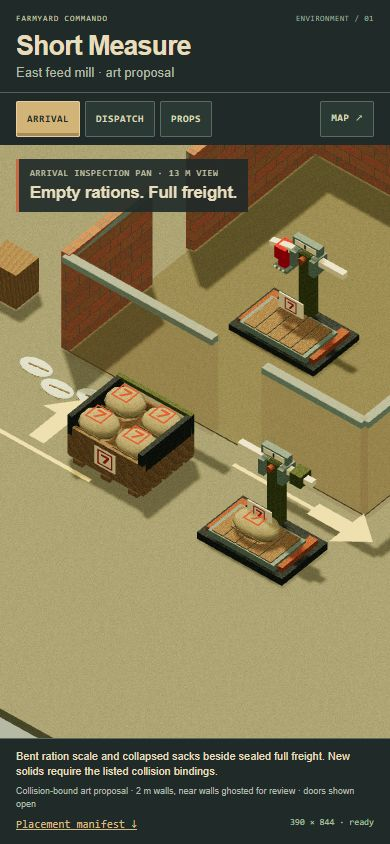
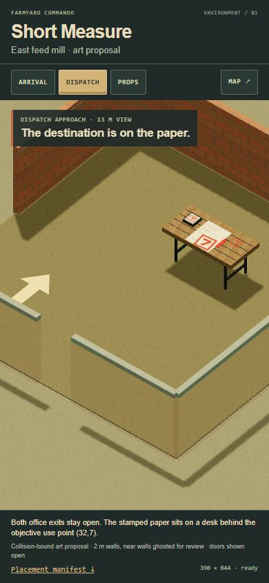
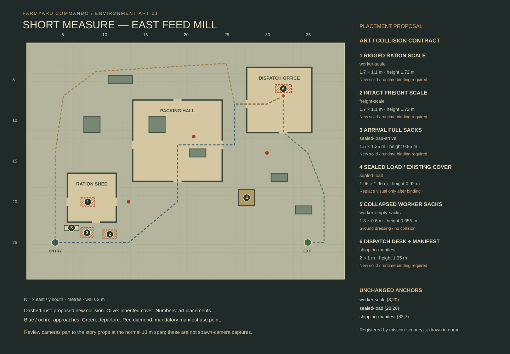

# Short Measure environment art

First pass for the east feed mill, based on the architect's blockout at design commit `5524d91b3971328f27ccc9bb50b41ce7d2a19482`. This branch starts at public `origin/main` commit `85c8a2e`. It adds an art kit and review page; it does not install a runtime mission, change controls, merge the switch study, or publish the game.

**Installed in play (2026-10-28).** `mission-scenery.js` now registers every solid below with the simulation, and `mission-art-view.js` draws the kit in Short Measure. See [Environment art in play](../../short-measure-runtime.md#environment-art-in-play). Two authoring changes came with the installation:
- The sealed load is sized to the runtime crate collider (1.96 × 1.96 × 0.92 m). The 2 × 2 × 1 m proposal could never bind.
- The full loads' corner posts end at the load height. A fixed post reached 0.935 m.

The worker station has an empty platform, a bent ivory beam and a red welded stop. The matching freight station has a level beam, intact counterweight and a full sack. Collapsed pale sacks sit beside a full outbound cargo bin. The same seven-in-a-square stencil appears on the scales, sacks, cargo seal and dispatch paper. Broad shapes and inherited materials carry the story at phone scale.





These are rendered model views, using the game's `(10,14,12)` camera offset and **13 m vertical span** across the full **390 × 844 canvas**, with review controls overlaid. Arrival is an inspection pan to `(8.1,22.5)`, not a capture from spawn `(4,25)`. The original spawn frame cannot show both distant authored story anchors at this phone width. The optional arrival freight bay and second scale bring the contrast beside the ration lane without moving the stable anchors. The office view targets `(31.2,7.8)`.

All walls remain **2 m high**. Near walls are ghosted in the review; their full geometry and footprints remain visible. Doors are shown open. Runtime cutaways must use the game's own foreground-wall treatment and must not alter collision. This review has no player, combat simulation, fog or mission navigation.

## Placement contract



Coordinates below are blockout `(x,y)` / renderer `(x,z)`, with north at the top. Sizes are width × depth × maximum height, in metres. All props face south, yaw `0`. Footprints are `[west,north,east,south]`. The machine-readable [placement manifest](../../../sites/tactical-animal/dist/mission-art/short-measure/placements.json) also records every paint marking, source, license status, anchor, offset and adapter hook.

| Stable art ID | Anchor / visual center | Size | Navigation reservation | Status |
| --- | --- | --- | --- | --- |
| `worker-scale` | `(8,20)` | 1.7 × 1.1 × 1.72 | `[7.15,19.45,8.85,20.55]` | Registered solid; its clue marker floats above it |
| `freight-scale` | `(10.7,24)` | 1.7 × 1.1 × 1.72 | `[9.85,23.45,11.55,24.55]` | Registered solid beside outbound lane |
| `sealed-load-arrival` | `(7.9,23.8)` | 1.5 × 1.25 × 0.95 | `[7.15,23.175,8.65,24.425]` | Registered solid; shares `sealed-load` story identity; crate cover |
| `sealed-load` | Anchor `(28,20)`; art center `(27.5,19.5)` | 1.96 × 1.96 × 0.92 | `[26.52,18.52,28.48,20.48]` | Replaces the visual of cover rectangle `[27,19,2,2]`; its four crate cells remain the collider |
| `worker-empty-sacks` | `(6,23.2)` | 1.8 × 0.6 × 0.055 | None; visual bounds `[5.1,22.9,6.9,23.5]` | Decorative ground dressing |
| `shipping-manifest` | Use point `(32,7)`; desk center `(32,6.1)` | 2 × 1 × 1.05 | `[31,5.6,33,6.6]` | New solid behind the unchanged objective use point |

The empty sacks are only 5.5 cm high and never provide cover. Floor bars/arrows are paint at 2.2–3.2 cm and have no collision or occlusion. `ration-shed`, `packing-hall` and `dispatch-office` retain their authored boundaries and all door gaps. The proposed navigation reservations leave all authored approaches, departure segments, door centers, guard posts, spawn, extraction and objective use points clear with 0.28 m clearance.

Height is an envelope, **not an opaque box**. The scale beams and desk legs contain visible open air. Sight, bullets and grenades must query the kit's supplied solid mesh parts, using their copied world transforms. The full cargo has a visible closed timber base; sack geometry and frame provide its upper silhouette. Do not hide an unchanged tall crate collider inside this model. If the runtime still requires opaque box scenery, keep the inherited cargo and omit bespoke solids for the first playable slice.

## Adapter handoff

**Where each numbered step below now lives at runtime:**
1. `createMissionArt` returns `null` off Short Measure.
2. `missionScenery()` registers each new prop's ground reservation and all 108 solid parts.
3. `missionArtBindings()` reports exactly what was registered. For `sealed-load` it reports the envelope of the crate cells actually on the map.
4. `tools/short-measure-art.mjs` precomputes `solidParts()` into `solids.js`, and a test rebuilds it from the kit.
5. The four crate tiles are handed to the kit only when it accepts the model.
6. `setCollected` follows the objective on every view update, including resume.
7. `FieldView.clearEnvironment` disposes the mission art before its generic traversal. The paper texture belongs to the view.

The kit lives in [kit.js](../../../sites/tactical-animal/dist/mission-art/short-measure/kit.js). It imports inherited primitive/model/material modules, generates eight small deterministic material textures in memory and uses no AFT PNG catalog fetch. The only optional external texture is the supplied `shipping-manifest.svg`. The standalone `reserve-7.svg` is reusable at any resolution; model seals use matching native geometry.

1. Select `short-measure` before importing/creating this kit. Other missions should not request these assets. The convenience `createShortMeasureArt({missionId,...})` returns `null` for a different mission.
2. Register matching navigation and per-part occlusion geometry in the authoritative simulation. The existing solo renderer has no such mission-art registration hook; that adapter is still required. Do not derive permission to draw a solid from a story marker's decorative status.
3. Only after registration, supply `bindings[id]` with `{owner, footprint, height, occlusion:{mode:'solid-mesh-parts',shapeKey}}`, using the exact manifest values. `bindingFor(placement)` describes the expected contract; it does **not** create or verify live simulation collision. The review uses these declarations as proposed bindings in a nonplayable scene. Unbound/mismatched solids return `null` and are reported in `skipped`; safe flat dressing remains available.
4. `createShortMeasureKit()` exposes `createProp(kind,{size})` for authoring and `place(id,{binding,collected})` for placement. To register geometry before placing it in the scene, create the model off-scene, copy the manifest translation/yaw, and call `solidParts(model)`. Each result supplies borrowed `geometry`, copied `matrixWorld` and primitive `shape`; do not dispose the borrowed buffers. No single opaque envelope should replace these parts for LOS/projectiles.
5. Replace only the visual owned by `cover:27,19,2,2` for `sealed-load`. Preserve its inspect point `(28,20)`. Hide the old cargo visual only after accepting the new model and occlusion binding. Never render both. If the runtime's cover height differs from 1 m, the binding deliberately fails until the authoring dimensions and simulation agree.
6. Keep collection at `(32,7)`, 0.4 m south of the desk footprint. The paper center is `(32,6.18)` at roughly 1 m. Call `setCollected(true)` on the art adapter, or `kit.setCollected(desk,true)`, when collected and on saved resume. This hides only paper and its red tab; the desk and its collision remain.
7. On mission switch, unregister physics/occlusion parts first, remove the art, then call `dispose()`. Disposal is idempotent. The kit owns its geometry, materials and generated textures; an optional `paperTexture` belongs to the caller. The review closes its renderer, shadow map and borrowed texture on `pagehide`.

The additional freight scale and arrival bay are proposals requiring architect/coder acceptance. The original mission remains completable with inherited cargo while these assets are reviewed. No action text, AP rule, save migration, minimap, door state or mission objective is implemented by the art kit.

## Source and rights record

Sacks, seams, pallet slats, table legs/top and their geometry/material recipes come from the user-supplied **AnimalFactory3D** snapshot at `a20b343a0234b5d8b365a4e1668961ca1bf37653`. Full sacks reuse the inherited `sandbags` crown; empty sacks flatten and lighten it. The table reuses `table-wood`, and cargo reuses `pallet`. The weighing mechanisms, stencil, lane paint and manifest illustration are original project contributions. All inherited files remain unchanged; their recorded provenance hashes continue to pass.

The repository/provenance does **not** declare an upstream license for the inherited art or a project-wide license for new art. This manifest records that status and the user's reuse direction; it does not relabel those assets as MIT. Three.js has its separate MIT notice at `aft/tactics/vendor/THREE-LICENSE.txt`. Exact paths and per-source rights notes are in `placements.json`.

## Review and regeneration

Run from the repository root:

```text
node sites/tactical-animal/tools/short-measure-art.mjs
npm run check
npm run build
npm run serve
```

Open `/mission-art/short-measure/review.html` on the local preview. The generator rebuilds `placements.json`, both copies of the top-down SVG and the simulation's `solids.js` from the authored manifest, the kit's models and the frozen Short Measure blockout. The review page itself stays separate from `game.html`; the game imports the kit through `mission-art-view.js`.

Validation and browser evidence are recorded in [review.json](review.json). Preview helpers are stopped after QA; no server is retained for this handoff.
