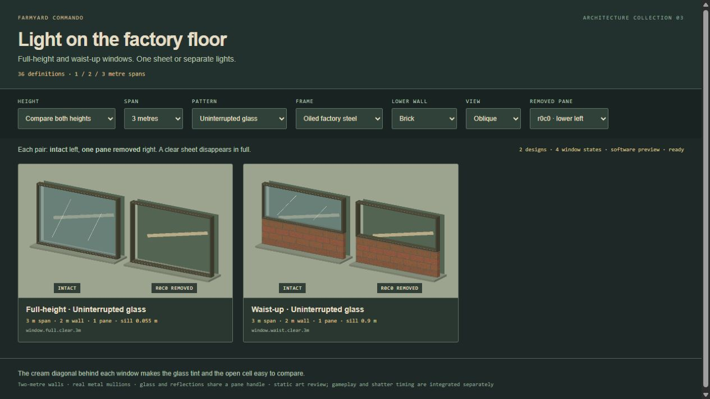
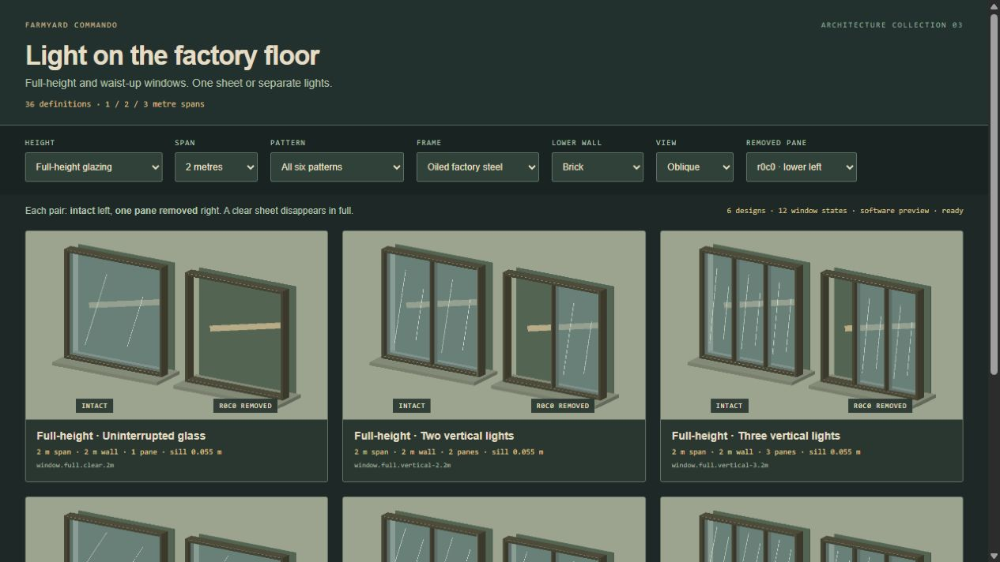
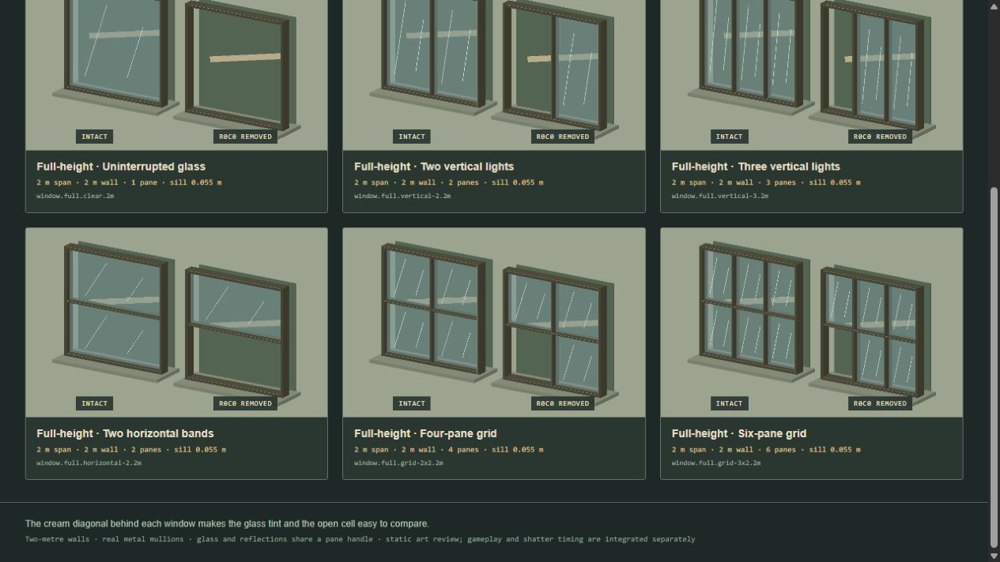
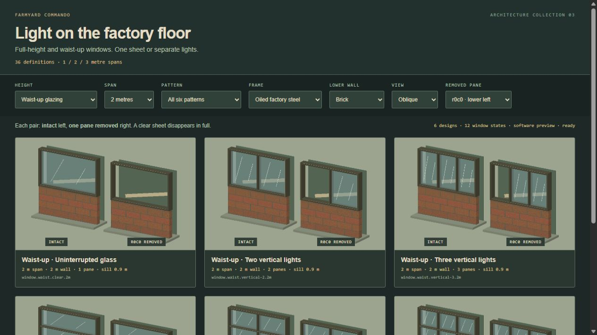
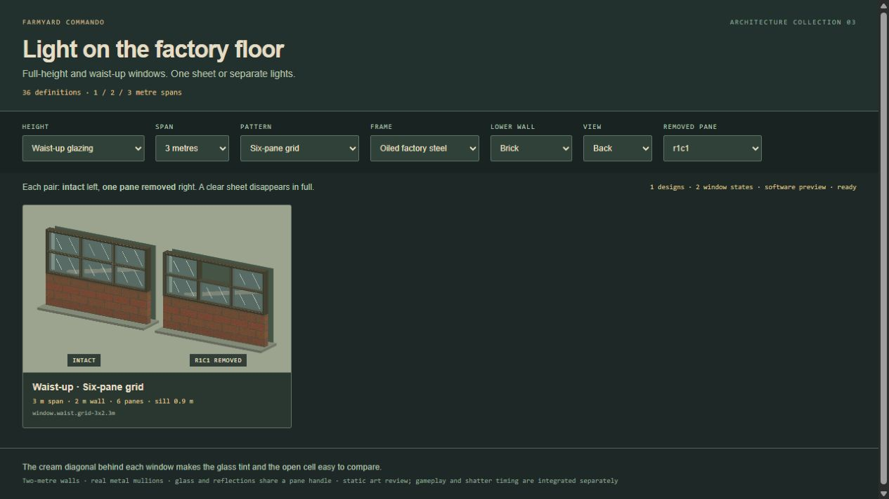
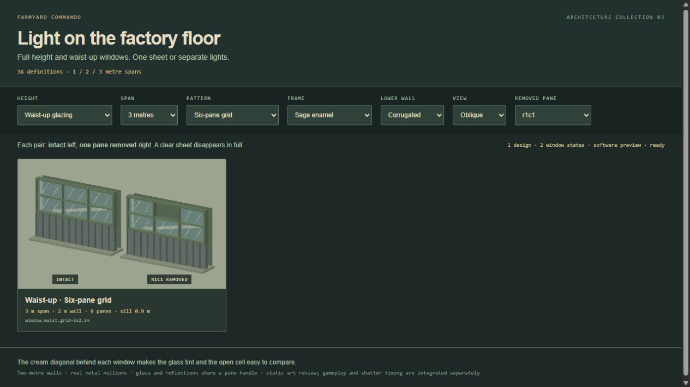
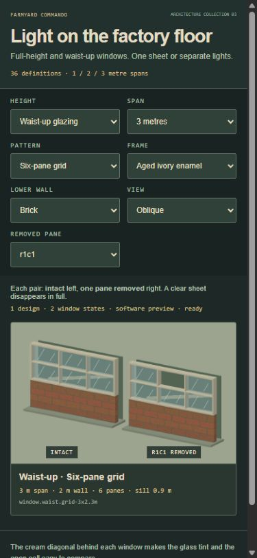

# Industrial window family

36 definitions: full-height and waist-up glazing × 1/2/3 metre spans × six patterns. Patterns are `clear`, `vertical-2`, `vertical-3`, `horizontal-2`, `grid-2x2`, and `grid-3x2`. Each definition supports steel, sage enamel and aged ivory frames, and brick/concrete/corrugated lower walls. This is the art and geometry contract; the coder owns break rules, effects, collision decisions and save state.



## Contract

Pure definitions: `sites/tactical-animal/dist/art/windows/catalog.js`. Import `WINDOW_IDS`, `WINDOW_DEFINITIONS`, `WINDOW_METRICS`, and `describeWindow(id, joins = {})`. IDs follow `window.<full|waist>.<pattern>.<1|2|3>m`, for example `window.full.clear.3m` and `window.waist.grid-3x2.2m`.

Metres, local X across the whole span, Y up with the floor at zero, glass centre plane Z=0 and outward normal +Z. The root is centred on the span. Walls are 2 m high and .16 m thick; metal frames are .20 m deep. Frame posts are .055 m wide; internal mullions .035 m. Glass is .008 m thick. Full glazing is clear from Y=.055 to 1.945; waist glazing from Y=.90 to 1.945, over a solid lower wall up to .845. The horizontal sill occupies .845–.90.

`describeWindow` returns immutable `panes` and `solids` arrays. Every entry has exact local `bounds: {min:[x,y,z], max:[x,y,z]}`. Panes additionally have `id`, zero-based `row`/`column`, `center`, `width`, `height` and `normal`. Rows run **bottom-up**, columns left-to-right when viewed from local +Z. IDs such as `r0c0` and `r1c2` are stable within a definition. A clear 3 m window is one pane (`r0c0`); tile seams create neither mullions nor extra panes.

`solids` includes perimeter frame, sill, actual mullions and the waist lower wall. Its entries carry stable `id`, `role`, `material` and `bounds`. Glass and reflection marks are separate. Removing a pane cannot remove any entry from `solids`.

Optional `joins: {left:boolean, right:boolean}` defaults to false on both sides. Set both touching flags true for two aligned windows of the same height, finish and wall style. Each contributes half a post at the seam, yielding one .055 m post rather than .11 m of doubled frame. Joins change the edge pane bounds, never its ID. Include the returned `cacheKey` (definition + joins) in geometry and hit-table caching. A single 2/3 m definition needs no internal join flags. Adjacency compatibility is the consuming editor's responsibility.

## Native factory

```js
import {createWindowLibrary} from './art/windows/geometry.js';
const library = createWindowLibrary();
const asset = library.build('window.waist.grid-3x2.2m', {
  finish: 'steel', wall: 'brick', joins: {left:false,right:false}, rotation: 90,
});
asset.root.position.set(worldX, floorHeight, worldGroundY);
scene.add(asset.root);

// Apply authoritative saved state; this changes presentation only.
asset.setPaneVisible('r0c1', false);
const handle = asset.panes.get('r1c2'); // {root, glass, shine, bounds, ...}
const bounds = asset.paneWorldBounds('r1c2'); // {min,max}, current world AABB
const solids = asset.solidParts();
const glass = asset.paneParts(); // visible panes; {includeHidden:true} includes all
```

`build(definitionId, {joins, finish, wall, rotation})` returns `root`, `spec`, a pane-ID `Map` named `panes`, `setPaneVisible`, `isPaneVisible`, `paneWorldBounds`, `solidParts`, `paneParts`, `dispose`, and `disposed`. Rotation accepts 0/90/180/270 **Three +Y degrees**. The coder's placement record is `{id,definitionId,x,y,z:0,rotation,joins}`, with x/y the world ground centre; the consumer converts the floor level to renderer Y. No placement state is stored in a definition.

Hiding a pane toggles its glass and reflection group together. `solidParts()` and `paneParts()` provide borrowed Three geometry plus copied current `matrixWorld`; pane parts carry their stable ID. `paneWorldBounds` is an axis-aligned world box, not a local shatter shape. For fracture, use the exact local pane bounds and transform the effect with the window root. Requery current matrices after moving a root.

The factory owns shared box geometry, materials, generated textures and each asset's wall/reflection geometry. Dispose an asset when removed; dispose the library on unload. Consumers must unregister borrowed collision geometry first. There are no image fetches, sounds, timers or animation loops in the factory.

## Consuming placement notes

Legacy `WALL_DIMENSIONS.length` is 1.12 m: adjacent legacy wall overhang can cover .055 m end posts. The consuming placement layer must suppress every covered wall edge across a multi-metre span and trim adjoining overhang where needed. A window span is its true width, not a row of legacy wall meshes. The frame extends .10 m each side of the glass plane; ejecting shards need at least this clearance plus their own radius before falling.

The art factory does not add vaulting, state persistence or hit rules. Lower walls, frame and mullions remain physical solids; clear glass is transparent to sight. Pane disappearance is the presentation hook for the coder's authoritative break state and the existing AFT effect.

## Catalog review

Run `npm run build`, serve the project locally, then open `/art/windows/index.html`. The catalog shows two native assets per card: intact left, the selected pane removed right. If a requested pane ID is absent from the selected pattern, the card uses and labels the last actual pane. Compare both heights, all spans, all six patterns, finishes and lower walls, with front/back/oblique cameras. The cream diagonal behind the aperture makes glass tint and open cells easy to compare.













All 36 definitions rendered as 72 intact/missing states; all 36 pair images loaded at 768 × 480 pixels with no browser warnings or errors. Front, rear and oblique views were inspected, along with steel/sage/ivory frames and brick/concrete/corrugated lower walls. At the 390 × 844 phone viewport, content width was 375 px (the vertical scrollbar accounts for the remainder), and the card stayed inside it without horizontal overflow.

The review browser could not create a WebGL context. Screenshots use the catalog's software rasterizer with the actual Three.js triangles, generated textures, transparent glass and reflection lines. Approximate lighting is used; native WebGL shading and in-game shadows have not been visually verified in this session. The factory itself remains a native Three.js asset and does not depend on the review renderer.

The generated [catalog.json](../../../sites/tactical-animal/dist/art/windows/catalog.json) includes every pane/solid bound and normalized source hashes. Regenerate with `node sites/tactical-animal/tools/window-catalog.mjs` after changing window sources. The [review record](review.json) contains checks, source hashes and screenshot hashes. Temporary review helpers and the owned browser tab are closed after QA.

## Provenance

Baseline: released Farmyard Commando main `6e47587`. Surface recipes reuse the pinned `aft/tactics/hybrid-materials.js` helper without editing it. The visual glass reference is the authoritative AFT study at `AnimalFactory3D/animation-studies/window-sneak`, commit `ebf51393909040b61a7c40649d9d5f0ac3678735`, specifically `dist/tactics/window-shatter.js` and `docs/tactics/WINDOW-SHATTER-STUDY.md`. The factory carries its cyan tint (`0x8eafb0`), roughness .3, metalness .25, opacity .56 and pale reflection strokes.

The source study is a presentation effect with fixed-size single panes; its gameplay integration is pending. Its old no-mullion description applies to those original panes. New divided windows deliberately retain their actual mullions when a cell disappears. This art module does not duplicate or adapt the shatter algorithm or audio; the coder consumes the existing study for those. The AFT/designer snapshots and source study remain untouched. No project-wide art license is declared; Three.js retains its separate MIT notice.

Validation: `npm run build` succeeds and `npm run check` passes all 304 tests. The eight window tests cover 576 definition/join/rotation cases, independently removable panes, uninterrupted multi-unit glass, joined posts, resource ownership, actual software alpha blending, generated source hashes and review entry dependencies. Run `node --test sites/tactical-animal/tests/window-art.test.mjs` for the focused suite.
