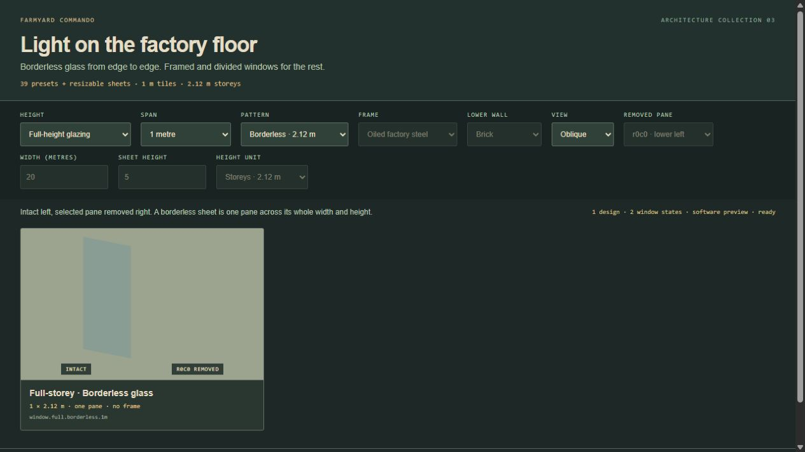
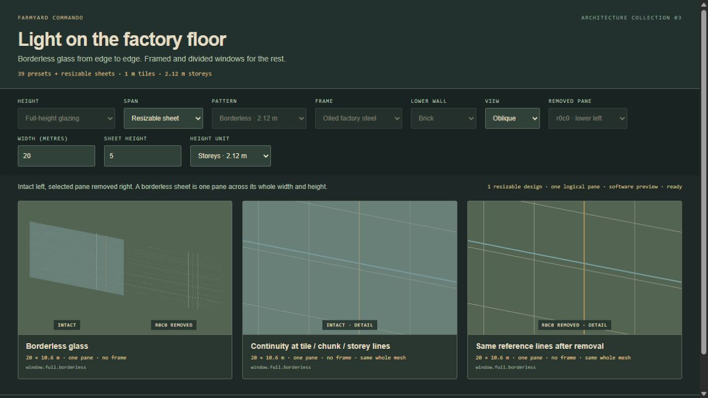
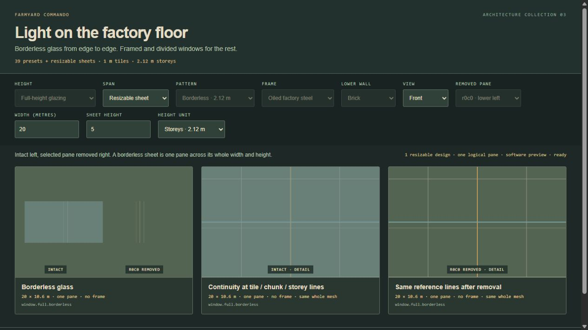
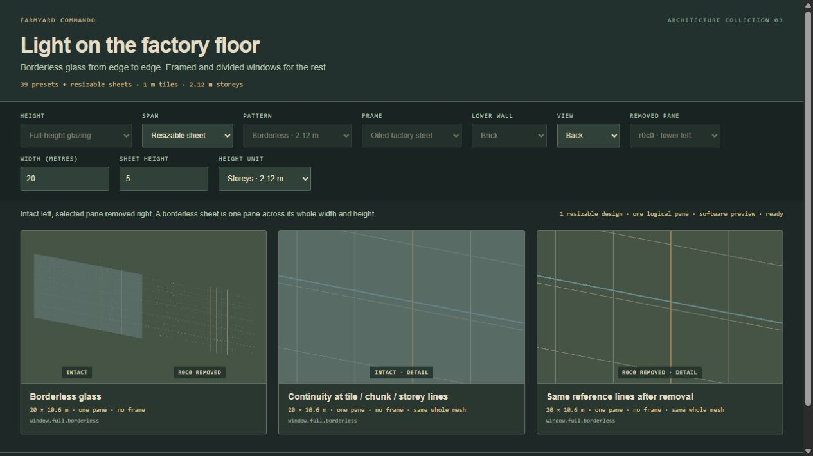
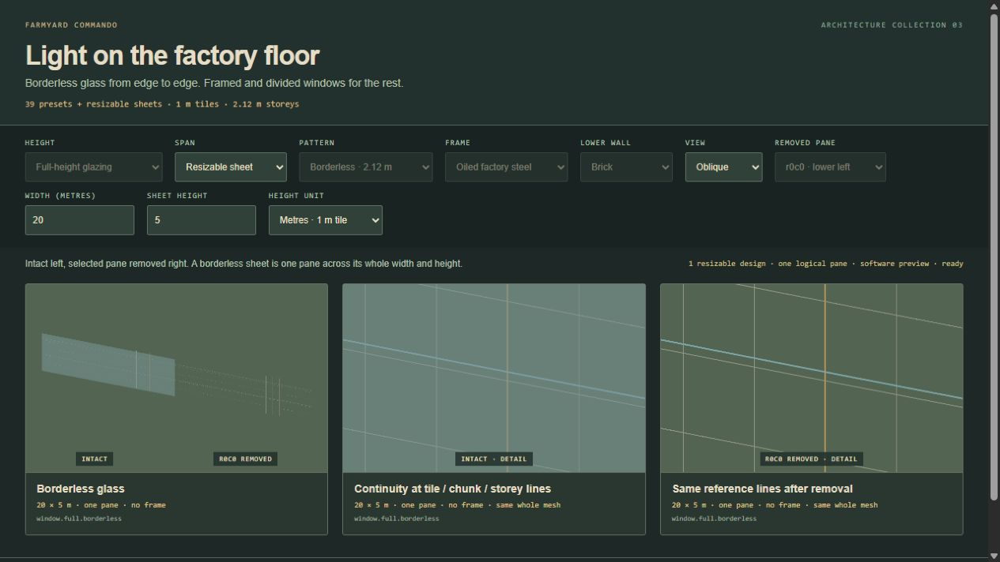
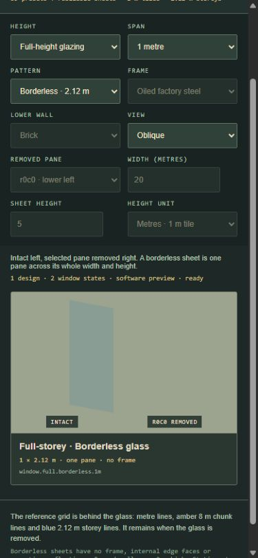

# Industrial window family

**39 presets plus resizable borderless glass.** The original 36 framed definitions remain compatible. Three borderless presets fill 1/2/3 m widths and the complete **2.12 m storey height**. The resizable template accepts independent width and height in metres; the presets are conveniences, not a size ceiling. This is native Three.js art and geometry. The coder owns the existing shatter adapter, hit rules, authoring and saved damage.



## Borderless dimensions and continuity

The 1 × 2.12 m preset contains glass from X=−.5 to +.5 and Y=0 to 2.12, with Z=−.004 to +.004. There is no frame, sill, mullion, lower wall, cap face or painted edge. Only the two broad glass faces are rendered. No repeated reflection strokes or texture are added to the surface. Adjacent modules meet without doubled end faces or an alpha-tinted seam; a single large sheet uses one shared unit geometry scaled across its full extent.

`WINDOW_METRICS.tile` is **1 m**. `WINDOW_METRICS.storeyHeight` is **2.12 m**, comprising the original 2 m wall plus .12 m slab. Keep these units explicit: 20 × 5 metre tiles is 20 × 5 m; 20 tiles wide × 5 storeys high is 20 × 10.6 m. Both examples are supported. Width and height are independent positive finite numbers; fractional metre dimensions are supported by the art factory. The consuming editor/runtime owns its explicit grid-alignment and placement restrictions.

```js
import {BORDERLESS_WINDOW_ID, WINDOW_METRICS, describeWindow} from './art/windows/catalog.js';
import {createWindowLibrary} from './art/windows/geometry.js';

const dimensions = {
  width: 20 * WINDOW_METRICS.tile,
  height: 5 * WINDOW_METRICS.storeyHeight, // 10.6 m; use 5 * tile for 5 m
};
const spec = describeWindow(BORDERLESS_WINDOW_ID, {}, dimensions);
const library = createWindowLibrary();
const asset = library.build(BORDERLESS_WINDOW_ID, {dimensions});
scene.add(asset.root);
// One authored sheet, one logical pane, irrespective of tile/chunk/floor lines.
asset.setPaneVisible('r0c0', false);
```

The template ID is **`window.full.borderless`**. Preset IDs are **`window.full.borderless.1m`**, `.2m` and `.3m`; they default to 2.12 m high. Both template and borderless presets accept the optional dimensions object. Existing framed IDs reject dimensions rather than silently changing their shape.

`describeWindow(definitionId, joins = {}, dimensions?)` returns immutable `dimensions`, effective `span` (width), `height` and `head`, `sill:0`, `borderless:true`, `depth:.008`, `frameDepth:0`, exact `bounds`, one `r0c0` entry in `panes`, and `solids:[]`. The existing `wallHeight:2` field still describes the ordinary wall metric; use **`height` or `bounds` for actual asset height**. Width and height are included in the geometry `cacheKey`. Joins never insert or reserve a borderless post. The nullable `shine` handle is `null` for borderless glass.

A single authored uninterrupted sheet is one pane even across tile, chunk or floor reference lines. It disappears and shatters as one pane across its entire extent. Separate neighbouring placements remain independently breakable: author one large template placement when one large sheet is intended, rather than a row of smaller placements.









## Origin, bounds and identity

Metres, local X across the full width, Y up from the glass bottom at zero, centre plane Z=0, front normal +Z. The root is centred horizontally. `build(definitionId, {joins, finish, wall, rotation, dimensions})` accepts 0/90/180/270 **Three +Y degrees**. Move its root to the required world ground centre and physical base height. A five-storey sheet remains one root spanning 10.6 m; stacking separate 2.12 m placements creates separate logical panes.

The factory returns `root`, `spec`, a pane-ID `Map` named `panes`, `setPaneVisible`, `isPaneVisible`, `paneWorldBounds`, `solidParts`, `paneParts`, `dispose`, and `disposed`. A pane handle contains `{id,root,glass,shine,bounds,center,width,height}`. Hiding a pane toggles its entire group. Borrowed geometry and copied current world matrices come from `paneParts()` and `solidParts()`; hidden panes are excluded unless `{includeHidden:true}` is passed.

- **Shatter/picking bounds:** use the exact local `spec.panes[0].bounds` and root transform. For a 20 × 10.6 m sheet they are `[−10,0,−.004]` to `[10,10.6,.004]`. `paneWorldBounds('r0c0')` gives the current world AABB; transform a picking ray into local space for an exact test after rotation. A world AABB is not a local fracture shape.
- **Save identity:** preserve the placement's unique `id`, `definitionId`, explicit metre `dimensions`, origin/rotation and the one `r0c0` damage state. Derive and validate bounds from the descriptor, not raw saved boxes. Geometry cache keys include dimensions and are not placement identity. Legacy framed placements may omit dimensions.
- **Residency:** keep the complete logical bounds and one asset/effect owner for the whole sheet. Keep it resident when any part intersects the visible region. Crossing chunk or floor boundaries must not clone overlapping transparent surfaces or split damage identity. Any internal tessellation must preserve the same logical pane and continuous surface treatment.

Do not cap borderless bounds at the ordinary 2 m wall height. The consuming wall/slab adapter must respect the full 2.12 m band and avoid leaving a frame-like strip through the glass. Covered legacy wall edges must be suppressed across the entire width. Legacy `WALL_DIMENSIONS.length` is 1.12 m; adjoining overhang needs clipping at the true edge. Framed windows have a .10 m frame half-depth for shard clearance; borderless sheets have no frame.

The library owns the shared box/sheet geometry, materials, generated wall textures and each asset's wall/reflection geometry. Asset disposal releases only its owned resources; library disposal releases shared resources once. Unregister borrowed gameplay geometry before disposal. The factory creates no image requests, sounds, timers or animation loops.

## Existing framed definitions

The original IDs follow `window.<full|waist>.<pattern>.<1|2|3>m`, where patterns are `clear`, `vertical-2`, `vertical-3`, `horizontal-2`, `grid-2x2` and `grid-3x2`. `clear` is a single **framed** pane; `borderless` is the new uninterrupted edge-to-edge surface. Framed forms retain their original dimensions: 2 m walls, .16 m lower-wall thickness, .20 m frame depth, .055 m posts, .035 m mullions, .008 m glass. Full framed apertures run Y=.055..1.945; waist apertures Y=.90..1.945 over a solid lower wall up to .845.

`panes` and `solids` entries contain exact local `bounds:{min:[x,y,z],max:[x,y,z]}`. Pane rows run bottom-up and columns left-to-right viewed from +Z. Stable pane IDs are `r0c0` etc. Divided panes retain actual mullions and adjacent glass when one section is removed. Optional `{left:boolean,right:boolean}` joins give each touching framed placement half of a .055 m post; they change edge pane bounds, not pane IDs. Include joins and dimensions in cache identity.

Framed forms support steel, sage enamel and aged ivory finishes, and brick/concrete/corrugated lower walls. Finish/wall selections have no visible effect on a borderless sheet. Existing AFT/designer snapshots and mission placements are unchanged by this art pass.


## Catalog and validation

Run `npm run build`, serve the project locally and open `/art/windows/index.html`. The default is the exact 1 × 2.12 m borderless preset. Choose **Span → Resizable sheet** to enter independent width and height, with explicit metre/storey height conversion. The custom review renders the whole sheet intact/removed and two close-ups of the **same full mesh** around the 8 m chunk and 2.12 m storey reference lines. Custom-sheet grid lines are behind the glass and remain after removal; they are not frame geometry. The review camera fits the whole declared extent rather than assuming a small window.

All 39 presets rendered as 78 intact/missing states. The 1 × 2.12 m preset and 20 × 5 m / 20 × 10.6 m sheets were checked in front/back/oblique views, whole and close-up. Phone layout was checked at 390 × 844; content width 375 px, card bounds X=16..359, no horizontal overflow. Earlier framed screenshots are retained from the preceding pass; their geometry remains unchanged.

The in-app browser could not create a WebGL context. Evidence is labelled **software preview**, using actual native triangles, texture pixels and alpha blending. Lighting is approximate; native WebGL shading and in-game shadows still need runtime review. The software renderer is a catalog dependency only. The generated [manifest](../../../sites/tactical-animal/dist/art/windows/catalog.json) records preset bounds, the parameter template and normalized source hashes. Regenerate it with `node sites/tactical-animal/tools/window-catalog.mjs`. The [review record](review.json) records source/evidence hashes and actual checks. Temporary review helpers and the owned browser tab are closed after QA.



Build passes and all **307 repository tests** pass. The 11 window tests cover 624 preset/join/rotation cases, arbitrary-size bounds at four rotations, whole-sheet disappearance, no borderless cap/trim/reflection geometry, source manifests, disposal and actual alpha blending. A pixel comparison verifies that sheets meeting at tile/storey boundaries match one continuous sheet in front/back/oblique software renders.

## Provenance

Baseline: released Farmyard Commando main `6e47587`. Surface recipes reuse pinned `aft/tactics/hybrid-materials.js` without editing it. The authoritative glass/shatter reference is `AnimalFactory3D/animation-studies/window-sneak`, commit `ebf51393909040b61a7c40649d9d5f0ac3678735`, specifically `dist/tactics/window-shatter.js` and `docs/tactics/WINDOW-SHATTER-STUDY.md`. Glass retains cyan `0x8eafb0`, roughness .3, metalness .25 and opacity .56. Framed forms retain pale reflection strokes; borderless sheets omit repeated strokes to preserve continuity.

The source study has fixed-size presentation panes. The coder adapts that existing effect and audio to authoritative gameplay; this art module adds no separate break simulation. No project-wide art license is declared; Three.js retains its MIT notice.
