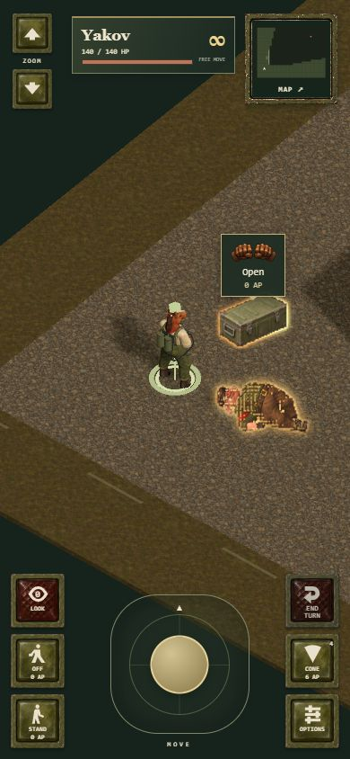
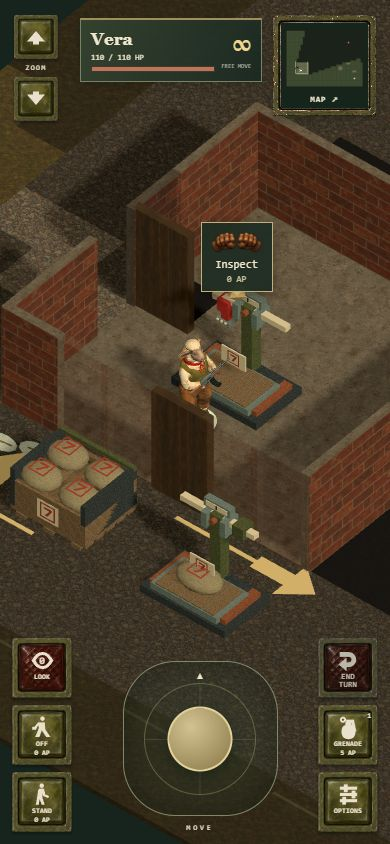
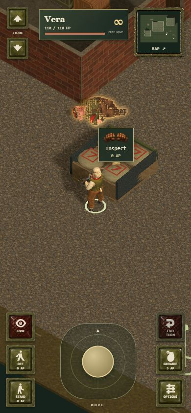

# Search halos and Short Measure integration review

Approved source work: `7db49df29a9ff412d06d205f4bc48f75297bce51` (animated search halos, including the wider body profile) and `6cd349fd71f5877521e8f43150b7e0bcd9599a33` (playable Short Measure art integration), based on deployed `fb386a5`.

The combined renderer preserves both systems' initialization, loading and disposal. Halos mark visible, searchable contents without changing AP, discovery or loot. Short Measure now draws its scales, empty sacks, sealed loads and dispatch desk against registered simulation geometry. The original two-metre walls remain intact.

Independent checks passed: all 285 tests, the production build, and `git diff --check`. The suite includes both complete Short Measure routes; scenery movement, sight, projectile, grenade and flame checks; save compatibility; and the fire, tank, Reload and halo regressions.

Release packaging now versions nested mission-art modules together with the application, including their relative imports and the standalone art-review entry. A regression test changes only a nested manifest and verifies that the whole release receives fresh URLs while pinned AFT imports and bytes stay stable. This prevents a returning browser from combining an old art kit with new collision bindings.

Real 390 × 844 browser checks verified the broader body contour and unchanged chest profile; foreground occlusion, line of sight, static reduced-motion presentation, opened lids and exhausted loot; native hand actions; raised scale inspection; Reserve 7 cargo inspection; manifest collection and paper removal after reload; switching from Short Measure to Night Ledger; and native extraction. The combined game emitted no browser errors or warnings.

Mission checkpoints were reached through production movement, combat, interaction and save commands using `tests/operation-scenarios.mjs`. No coordinates, HP, AP, ammunition, doors or quest flags were manufactured. A separate renderer fixture supplied explicit lighting, visibility and foreground-wall controls for the contour study. Private fixture pages are excluded from the production build.

