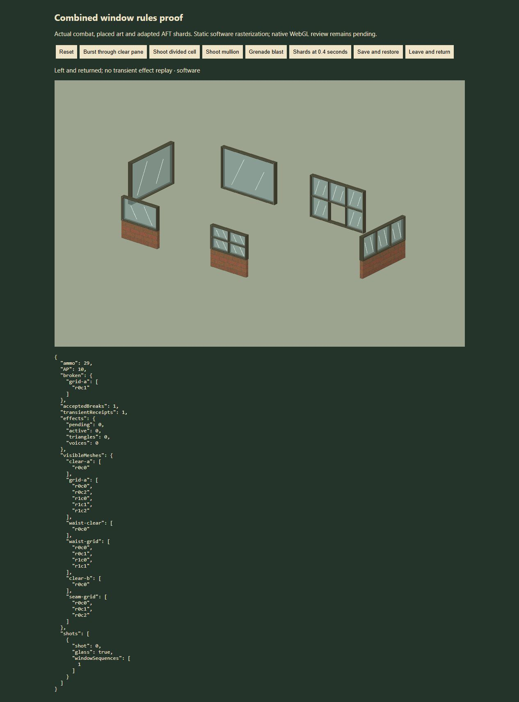

# Large breakable windows — integration review

Status: draft for combined review. The code and geometry checks pass; native WebGL shading, live field picking, editor placement and audible playback still need a graphics-capable browser pass before promotion.

This branch starts at released `6e47587` and includes artist commits `46a224b76ddeaf47156a7a118359530cc15cdd30`, `0ef5b7186970a32397a0c61bdedca2ba24c17c79`, and the clarified borderless contract `20eeaa65c4f64a11c0c6ffb270363746812d3668` from [art PR #24](https://github.com/Syntaxswine/farmyard-commando/pull/24). Local cherry-picks are `8ab521e`, `5c04afb` and `4c86517`. There are 39 presets plus the resizable borderless template. The original 36 framed definitions retain their IDs and bounds. Pane IDs, bounds and mesh handles come directly from the committed artist catalog and factory.

## Gameplay and authoring

The title screen's Map Designer opens a Farmyard wrapper around the existing pinned designer. Select a ground-floor wall, choose a window and frame finish, then Place at selected wall. Borderless custom sheets expose width in 1 m tiles and height in metres or 2.12 m storeys, with the resulting metre dimensions shown explicitly; frame finish is disabled for borderless glass. Wide windows start at the selected wall cell. Remove window restores its stored original edges. Export/import and undo/redo retain placement IDs, dimensions and the `farmyardWindows` extension. The pinned designer and AFT files remain byte-for-byte unchanged.

Open proving yard loads an encounter into the existing designer; Playtest map starts the actual `FieldView` and combat rules. `window-yard.html` also opens the default yard directly. Besides both heights, divided glass, repeated 3 m instances and four rotations, it contains 20 m × 5 m and 20 m × 10.6 m borderless sheets north of the small target frames, plus an independent repeated sheet. Their spans cross a 24 m render seam. Twenty old wall/window edges deliberately under one sheet must be suppressed. Playtests have their own save slot and do not change the three offered story operations. Tall glass adds no walkable upper floors; unsupported terrain/vertical traversal remains rejected.

Tap glass or a frame to confirm a normal shot or burst. Tapping a guard through transparent glass still selects the guard; the bullet simulation decides the first impact. A pane stops and breaks on its first accepted hit, while later burst rounds can pass through its hole. Frames, mullions, sills and lower walls retain actual height and collision. Clear glass is transparent to sight and blocks flame until broken. Walking through broken windows remains unavailable; no vault mechanic is introduced.

Save data stores breakage by placed instance plus pane ID. Transient cues are omitted from saves. Accepted events consume no combat randomness; repeat hits on a hole, restore and chunk revisits do not create new break events. Grenade/RPG/fuel blast paths can break several independent panes using their existing blast rules.

## Verification

All **345 tests** pass, as do `npm run build` and `git diff --check`. Focused tests cover all rotations, real pane ray hits/heights, lower walls/mullions, full-span breakage, divided independence, repeated instances, burst continuation, grenade/tank blasts, partial-window flame previews, legacy compatibility, invalid/missing dimensions, editor history/export, wall-end clipping, shader-buffer representability, shard ground contact, receipt deduplication, delayed audio disposal and chunk revisits. A 20 m sheet remains one asset when only its outer portion intersects a resident rectangle, and an accepted hit at 9 m breaks it as one pane. The artist tests include 624 preset/join/rotation combinations and pixel-identical continuity checks between touching sheets and one continuous surface. Nested window art and new entry scripts share the game's cache version.

The browser reported `GL_VENDOR = Disabled`, `GL_RENDERER = Disabled`, and `Error creating WebGL context` in both the actual field and the pinned editor. See [field limitation](webgl-unavailable.jpg) and [editor limitation](editor-webgl-unavailable.jpg). Native visual and audio approval is therefore pending.

The architect-requested native recheck on 2026-10-29 produced the same failures in both entry points: [field](native-followup-2026-10-29/field.jpg), [editor](native-followup-2026-10-29/editor.jpg), [console evidence](native-followup-2026-10-29/browser-errors.json). The connected inventory exposed the in-app browser and an empty MCP Apps surface, with no other browser available for this review. No graphics settings or environment flags were changed. Live placement/removal, ordinary native undo/redo/import, transparent shading/shadows and audible playback remain unapproved.

Code inspection found that the wrapper refreshed buttons during the pinned editor's busy selection callback but did not refresh after its async `changed()` cleared that flag. The wrapper now schedules one deferred completion refresh from scene callbacks and cancels it during teardown/reconnect. Regression tests exercise the callback order with actual document undo/redo and a simulated import completion; these are not claimed as native browser input tests.

A temporary browser proof exercised the actual `Core`, `WindowScenery`, `WindowEffects` and reused study against the artist's existing software geometry rasterizer. It is clearly labelled software, and is outside the shipped app:

| Browser action | Observed result |
| --- | --- |
| Three-round burst | Ammo 30→27, AP 14→8; one `clear-a/r0c0` break; later rounds hit guard 1; repeated `clear-b` stays intact. |
| Divided-cell shot | Only `grid-a/r0c1` disappears; its five neighbours and structural members remain. |
| Mullion shot | Ammo 30→29, AP 14→10; zero accepted breaks or shards. |
| Grenade | Two independent nearby panes break, two effects, 140 triangles. |
| Save/restore | Hole retained; zero transient receipts, effects or shards replayed. |
| Leave/return | Hole retained; zero new effects. |
| Phone 390×844 | Actual pane geometry and state report remain readable in the software proof. |

Other captures: [burst](burst-clear-software.jpg), [source shards](shatter-software.jpg), [restored](restored-software.jpg), [phone](phone-software.jpg). Software rendering does not verify native shading, vertex-colour fidelity, live field controls, or audible playback.

## Resizable borderless follow-up

The final asset API is `describeWindow(id,joins,dimensions)` and `library.build(id,{dimensions})`. The dynamic ID `window.full.borderless` requires persisted `{width,height}` in metres. Three borderless presets default to a 2.12 m full storey. Ordinary framed walls remain 2 m; 2.12 m is a pitch/preset, not a height ceiling. Runtime authoring uses whole metre wall spans inside the 240 m sector; the art factory supports fractional sizes. Height validation rejects malformed or unrepresentable coordinates, rather than imposing a storey-count cap. Saved raw bounds never replace computed asset bounds.

The real wrapper controls were exercised on desktop and at 390×844: `20 × 5 metres` displayed `20 × 5 m`; changing only the height unit to storeys displayed `20 × 10.6 m`. The phone wrapper has no horizontal document overflow and disables frame finish for a borderless sheet. This verifies the dimension controls, not the unavailable native 3D editor. See [desktop controls](borderless/dimension-controls.jpg), [phone controls](borderless/dimension-controls-phone.jpg), and [layout values](borderless/phone-layout.json).

The actual-rules software proof isolates the real 20 m × 10.6 m artist mesh for inspection. One shot at 9 m consumed one round and 4 AP, removed the whole `borderless-five-storeys/r0c0` pane, emitted one break event and one 64-triangle effect, and left the repeated and 5 m-high sheets intact. Saving/restoring and leaving/revisiting retained dimensions and the hole with zero transient receipts, effects or voices replayed. See [whole sheet](borderless/whole-sheet-software.jpg), [high shot](borderless/high-hit-software.jpg), [shot report](borderless/high-hit-report.json), [restore](borderless/restored-software.jpg), [restore report](borderless/restored-report.json), and [phone geometry](borderless/phone-software.jpg). The native review gate remains pending.

To reproduce this optional proof from the repository root, run `npm run build`, then `node docs/reviews/window-pane-integration/prepare-window-proof.mjs`, and serve the generated `dist/window-proof.html`. A fresh `npm run build` removes the private proof files from the app build.

## Reused source and limits

The authoritative shatter study is `AnimalFactory3D/animation-studies/window-sneak` at `ebf51393909040b61a7c40649d9d5f0ac3678735`. The adapter keeps its deterministic triangular fracture, analytic metre-scale gravity, rigid ground clearance, bounce and fade. It now accepts actual pane bounds and clears the new .20 m frame depth before falling. Source and audio hashes, adaptations and rights are in `sites/tactical-animal/window-shatter-provenance.json`. The original recording and license retain their exact bytes; the recording is rubberduck's `bfh1_glass_breaking_01`, CC0, with the original credit/source/deed retained in `dist/assets/audio/GLASS-SMASH-RUBBERDUCK-LICENSE.md`. No project-wide license was declared for the user-supplied study code; reuse follows the user's explicit direction. Three.js retains its existing MIT notice.

Only flat receiving floors at height 0 are supported. Shards are cosmetic and do not collide with nearby props. Six live shard meshes share 210 triangles; every sheet stays within 70 triangles regardless of area. Tall fragments retain 7.8 m/s² gravity and get enough analytic time to land before fading, while canonical small-pane timing remains 2.2 seconds. Reduced-motion, offscreen and excess-budget effects can be omitted without changing damage. Audio requires a browser gesture, obeys the proving-yard mute control, and is limited to three voices. Cosmetic loading or autoplay failure never blocks combat.

The local helpers and restart records are under `artifacts/preview/window-helper.json`, `window-native-helper.json` and `window-borderless-helper.json`. Each had an actual 30-minute expiry and was stopped after its immediate review; receipts verify the processes exited and port 4514 was released. Temporary tabs are closed and viewport overrides reset. No service or private proof page is retained for this draft.
